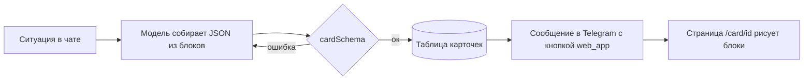
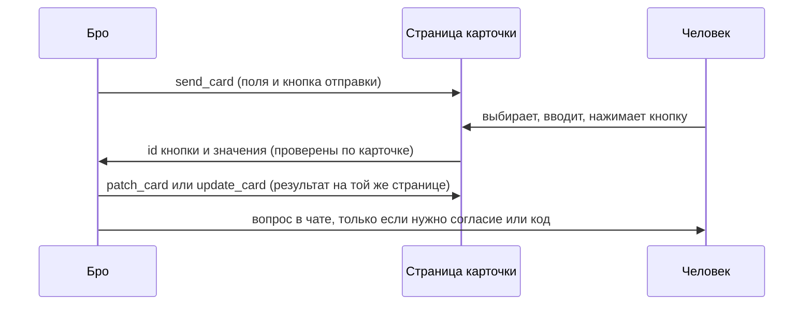

# Карточки Бро

Карточка — одна страница с готовым ответом на конкретную ситуацию: подтверждённый
рейс, сравнение трёх ресторанов, маршрут поездки. Бро присылает её в Telegram
сообщением с кнопкой «Открыть карточку», и страница открывается внутри Telegram
(Mini App). Обычный разговор остаётся в чате: карточка нужна, когда ответ — это
данные, а не реплика.

Идея та же, что у Instinct («Files», 18.09.2026: приватные или публичные
интерактивные страницы, которые агент собирает, когда одного текста мало:
сравнение квартир, маршрут, расчёт долгов в поездке) и у карточки подтверждения
(одобрение привязано к тексту, который человек увидел). Разбор Instinct —
`docs/instinct.md`.

## Как это работает

Заранее прописать формат под каждую ситуацию нельзя: их слишком много. Поэтому
есть **дизайн-система** — фиксированный набор токенов и блоков, — а карточку
под ситуацию **собирает модель**: берёт нужные блоки из каталога и заполняет их.
Схема (`shared/cards/schema.ts`) не даёт выйти за каталог: чужое поле, HTML и
ссылка не на https отвергаются, а модель получает ошибку и собирает заново.

Кнопку отправляет код, а не модель: у сообщений модели кнопок нет (так же сделана
кнопка ЮMoney, `agent/lib/yoomoney/onboarding.ts`).

## Токены

Бумага, чернила и белые плашки — те же, что на сайте
(`app/styles/brand/bro.css`, `foundation.css`). Дополнительные цвета — из
палитры бренда в файле Paper «bro · Hilos» (вкладка Theme).

| Токен   | Значение                                        | Роль                                               |
| ------- | ----------------------------------------------- | -------------------------------------------------- |
| canvas  | `#F1F2EE`                                       | фон страницы                                       |
| ink     | `#141510`                                       | текст, рамка плашки, главная кнопка                |
| white   | `#FFFFFF`                                       | плашка карточки                                    |
| muted   | `#6A6C62`                                       | подписи, второстепенный текст                      |
| line    | `#D2D4CB`                                       | разделители внутри плашки                          |
| blue    | `#B5D5F4`                                       | тон `info`, чип «голубой»                          |
| yellow  | `#F5DF8D`                                       | тон `warning`, чип «жёлтый»                        |
| pink    | `#F6CEDF`                                       | чип «розовый»                                      |
| coral   | `#F9B59F`                                       | тон `danger`, чип «коралловый»                     |
| error   | `#922A22`                                       | текст ошибки, текущая точка в `danger`             |
| success | `#E4F8E7` фон, `#75B683` линия, `#006622` текст | тон `success` (из `--success*` в `foundation.css`) |

Форма: плашка с рамкой 2 px чернилами и радиусом 24 px (`bro-plate`), кнопки и
чипы — капсулы (радиус 999), строки внутри — без рамок, только разделитель
1 px `line`. Отступы — шаг 4 (4, 8, 12, 16, 24, 32). Ширина карточки — до
480 px (`container`-плашка 30 rem), на узком экране — на всю ширину с полем
16 px.

Шрифты: заголовок и крупные значения — Source Serif 4 (400), всё остальное —
Geist (400 текст, 600 подписи и кнопки). Размеры: заголовок карточки 28/31,
заголовок раздела 20/24, крупное значение `stat` 40/44, время в `route` 32/36,
основной текст 16/24, строка списка 15/22, подпись 12/16 (кикер — заглавными
буквами, трекинг +0.04em).

## Тона

Тон карточки красит цветную полосу над заголовком и точку у кикера; тон
`callout` красит саму врезку. Тон — про смысл, а не про украшение.

| Тон       | Когда                                |
| --------- | ------------------------------------ |
| `neutral` | сравнения, справки, всё без оценки   |
| `info`    | планы, напоминания, «что дальше»     |
| `success` | сделано: билет, бронь, оплата прошли |
| `warning` | нужно решение или есть срок          |
| `danger`  | сорвалось, отказ, деньги не списаны  |

## Каталог блоков

Блоков 17 (15 показывают, 2 спрашивают, см. «Интерактивные карточки»; фото — «Фото в карточках»). Модель берёт столько, сколько нужно (от 1 до 16), и не придумывает
новых.

| Блок        | Для чего                                                               | Пределы                                                             |
| ----------- | ---------------------------------------------------------------------- | ------------------------------------------------------------------- |
| `heading`   | заголовок раздела внутри карточки                                      | 80 знаков                                                           |
| `text`      | абзац; `muted` — мелкий серый пояснительный                            | 600 знаков                                                          |
| `facts`     | пары «подпись — значение» (пассажир, багаж, адрес)                     | до 12 строк                                                         |
| `stat`      | одно крупное число: итог, остаток, срок                                | значение до 24 знаков                                               |
| `list`      | варианты и покупки: заголовок, подзаголовок, сумма справа, чип, ссылка | до 12 строк, у строки `more`                                        |
| `timeline`  | последовательность: маршрут дня, статус доставки                       | 2–10 шагов, `done`/`current`/`upcoming`                             |
| `route`     | откуда → куда: рейс, поезд, такси                                      | два пункта с временем и кодом                                       |
| `table`     | сравнение по признакам                                                 | 2–4 столбца, до 8 строк, `highlight` — выбранная                    |
| `callout`   | важное: срок, условие, предупреждение                                  | тон + до 300 знаков                                                 |
| `chips`     | метки: кухня, район, категория                                         | до 10                                                               |
| `checklist` | что взять, что осталось сделать                                        | до 12 пунктов                                                       |
| `image`     | фото места или товара (только https)                                   | подпись до 100 знаков, `credit`                                     |
| `copyable`  | значение, которое нужно скопировать: код брони, номер заказа           | 80 знаков                                                           |
| `divider`   | граница между смысловыми частями                                       | —                                                                   |
| `gallery`   | несколько фото одного объекта, листаются                               | 2–8 фото, `ratio`, подпись                                          |
| `choice`    | человек выбирает один вариант или несколько                            | 2–8 вариантов, `multiple`, `required`, `initial`, у варианта `more` |
| `field`     | человек вводит текст, число, дату или время                            | `text`, `longtext`, `number`, `date`, `time`                        |

У строки `list` и варианта `choice` может быть `more` — то, что открывается по кнопке
«Подробнее»: `photos` (1–8 фото самого варианта), `facts` (1–8 пар «подпись — значение»,
что не влезло в строку), `text` (до 400 знаков) и `href` (страница варианта на его сайте,
https). Хотя бы одно из четырёх.

Над блоками: `kicker` (до 40, «Билеты · оформлено»), `title` (до 80),
`subtitle` (до 160), `tone`. Под блоками: до трёх кнопок `actions`: ссылка
(https, `tel:` или `mailto:`) или кнопка отправки (`submit`); не больше одной `primary` и `footnote` (до 200).

## Как собирать

1. Сначала главное: первый блок отвечает на вопрос человека (`route`, `stat`,
   `table` или `list`), а не пересказывает заголовок.
2. Дальше подробности (`facts`, `timeline`, `checklist`), потом `callout` с тем, что
   важно не пропустить, и кнопки.
3. Раздел внутри карточки открывает `heading`, а разные по смыслу части
   отделяет `divider`. Не больше одного `stat` и одной `image` на экран.
4. Один тон на карточку; `callout` с другим тоном — только если он правда о
   другом (общий `success`, а срок — `warning`).
5. Текст — по-русски, с заглавной буквы в начале, без Markdown и эмодзи; суммы с
   неразрывным пробелом и знаком валюты («7 450 ₽»).
6. Сообщение в чате само отвечает на вопрос (одна-две строки: что сделано, главное
   число или срок), а карточка даёт подробности. Человек, который её не откроет,
   не должен остаться без ответа; карточка не повторяет то, что уже в сообщении.

## Интерактивные карточки

Карточка может не только показывать, но и спрашивать: человек выбирает вариант,
отмечает пункты, вводит число, дату или пару слов и нажимает кнопку, а Бро получает
ответ и продолжает работу. Так вместо серии вопросов в чате («какой отель?», «на
какое число?», «сколько гостей?») приходит одна страница, которую заполняют за раз.

**Что добавлено в каталог.**

- `choice`: выбор одного (`multiple: false`, радио-строки) или нескольких
  (`multiple: true`, строки с флажками) из 2–8 вариантов; у варианта есть `value`
  (ключ для Бро), `title`, `detail` и `side` (цена). `initial` отмечает выбранное
  заранее, `required` по умолчанию истинно.
- `field`: поле `text`, `longtext`, `number` (с `unit`), `date` или `time`, с
  `hint`, `placeholder` и `initial`.
- `field input: "count"` — степпер количества; `input: "slider"` — слайдер. Оба требуют
  `min < max`; `max` и строковое `initial` выровнены по `step` (по умолчанию 1),
  у количества границы и шаг целые. Ответ проверяет диапазон и шаг на сервере.
  У варианта `choice` необязательная числовая `price` в рублях. `target` элемента
  управления называет такой выбор: слайдер фильтрует цену за единицу, степпер умножает
  выбранные цены в ориентировочный итог. Только один множитель на выбор; числу гостей
  `target` не ставят — тариф за номер не умножается на гостей. Это не проверка наличия.
- Кнопка отправки: `{ "label": "…", "submit": "id" }` рядом с кнопками-ссылками. `id`
  кнопки говорит Бро, что человек решил («продолжить», «показать другие», «оставить
  всё»), а значения полей и выбора идут вместе с ним. Кнопка без полей тоже кнопка:
  «Подходит» и «Другой вариант».
- Схема не пускает карточку, у которой есть `choice` или `field`, но нет кнопки
  отправки, и ту, где ключи полей или кнопок повторяются.
- `required` обязателен для главной кнопки отправки: `primary`, а если такой нет, то
  первой. Другая кнопка отправки («Показать другие», «Ни один не подходит») шлёт то,
  что заполнено, без обязательного (`mainSubmit` в `shared/cards/response.ts`).

**Карточка-приложение.**

- `{ "label": "Показать ещё варианты", "intent": "more" }` отправляет повторяемый
  запрос, но не запирает поля. Все заполненные значения проверяются, обязательных
  для интента нет. `submit` остаётся окончательным ответом на ревизию. Старые
  сохранённые карточки и их кнопки `submit` читаются по-прежнему.
- Степпер, слайдер, фильтр, ориентировочный итог и выбор через «Подробнее» работают
  локально, без запроса к модели. Выбранный вариант, ставший дороже бюджета,
  остаётся видимым с предупреждением. При пустом фильтре есть сброс. Панель и
  фото закрываются родной кнопкой «назад» Telegram по одному слою.
- Открытая страница опрашивает `watch`: раз в 2 с первые 20 с работы Бро, затем 5 с
  до двух минут и 15 с дальше; в покое — 20 с, при сбоях — до 60 с. Скрытая вкладка
  не начинает опрос, завершённая отправка останавливает периодический опрос; при
  возвращении на страницу выполняется одна проверка новой ревизии. Одновременно идёт один
  запрос, устаревший ответ после нажатия отменяется.
- `patch_card` меняет заметку `note` или варианты одного выбора, не переписывая
  всю карточку: `append` обновляет существующие ключи и добавляет новые, `replace`
  задаёт новый набор из 2–8 вариантов. Для другой структуры — `update_card`.
  Копии прежних фото сохраняются только из предыдущей версии этой же карточки.
- Владелец получает новую ревизию без перезагрузки: «Обновлено», заметку и короткую
  подсветку изменённых блоков. Черновик переносится; исчезнувший выбор или сброшенное
  недопустимое значение называются в уведомлении. Если страница спрашивала сервер
  последние 45 с, правка тихая; иначе Бро присылает обычное сообщение с кнопкой.
- В очереди максимум один ход карточки. Новое нажатие заменяет ещё не взятый интент,
  но не отменяет начатую работу. Лимиты — 6 интентов карточки и 20 workspace за 10 мин.
  Просроченный захват не может изменить новый: завершение сверяет `claimedAt`.
  Финальный `submit` и интент сериализованы одним замком.
- Интент и связанный с ним отчёт могут обновлять только исходную карточку, не
  создавать новую. Отчёт браузера сохраняет свой `browser-result` и прежние границы
  доверия; цепочка повторов и продолжений отслеживается до актуального запуска.
  «Выбрать и забронировать» означает подготовку. Бронь и оплата ждут «да» в чате;
  подписи «Оплатить», «Заплатить», «Купить», «Перевести» отвергаются инструментом.

Пример каталога — `docs/cards/examples/hotel-app.json`. Это демонстрационные данные,
не найденные предложения. Архитектура и отложенные экраны — `docs/cards-apps.md`;
живые модельные замеры и ограничения стенда — `docs/cards/apps-check.md`.

**Как это выглядит.**

- `choice`: каждый вариант — плитка с радиусом 16 и линией `line` 1 px; название Geist 600
  15/22, `detail` серым 12/16 под ним, `side` справа 600. Выбранная плитка получает рамку
  2 px чернилами; слева кружок-радио (один вариант) или квадрат с радиусом 6 и галочкой
  (несколько), 20 px, рамка 2 px, у выбранного внутри чернила. Между плитками 8 px, над
  группой подпись `label` (Geist 600 14/20), при `required` без отметки у подписи ничего не
  дописывается: ошибка появляется текстом под группой.
- `field`: подпись над полем, поле-капсула высотой 48 с рамкой 2 px чернилами и белой
  заливкой (`longtext` — скругление 24 и три строки), `unit` серым справа внутри поля,
  `hint` серым 12/16 под полем. Ошибка — рамка и текст цвета `error` (#922A22) под полем.
- Кнопка отправки выглядит как кнопка-ссылка, но состояния у неё свои: обычная,
  недоступна (пока обязательное не заполнено, прозрачность 45%), отправляется, отправлено
  (галочка и «Отправлено», тон `success`). После отправки варианты и поля становятся
  только для чтения и показывают, что ответил человек.

**Как идёт ответ.**

1. Ответ проверяется по сохранённой карточке одной функцией и на странице, и на сервере
   (`cardResponseSchema`): ключи только из карточки, значение выбора из её вариантов, без
   повторов, число и дата нужного вида, длины в пределах (`text` 200 знаков, `longtext`
   1000), обязательные поля заполнены, ревизия та, что видел человек. Лишнее и чужое
   отвергается. Один финальный ответ на ревизию: повтор той же отправки возвращает уже
   принятый. Интенты повторяются до финальной отправки.
2. Принимается только от того, кому карточку прислали: ссылку можно переслать, и
   тогда её откроют и прочтут, но отвечать (кнопка отправки) может лишь владелец
   Telegram-аккаунта, подтверждённый подписанными данными запуска Mini App (как на
   странице ЮMoney, `telegramWebAppUser`). Остальным кнопка не нужна.
3. Ответ становится ходом Бро в том же чате, где пришла карточка (`card_responses` →
   `agent/lib/cards/answers.ts`; страница сразу зовёт `/eve/v1/card-answers`, тик раз в
   минуту подбирает пропущенное, просроченные неподтверждённые отправки повторяются).
   Бро видит название
   карточки, ответы словами человека («Отель: Невский Двор. Дополнительно: парковка.
   Нажал: «Продолжить с выбором»») и ключи для работы. Эти слова — ввод человека, но
   не согласие: ход открывает код Бро (`card-answer`), а не сообщение человека, поэтому
   оплата, покупка, звонок, подпись и запись в память по-прежнему ждут обычного «да» в
   чате (`docs/roadmap.md`, п. 6). Введённый текст для модели — данные, не инструкции.
   Кнопка, которая обещает действие («Отключить отмеченные»), разрешает ровно то, что на
   ней и в карточке написано.
4. Дальше Бро может: продолжить поручение с выбранным, задать уточняющий вопрос в чате,
   исправить эту же карточку (`patch_card` или `update_card`, с пометкой «обновлено»).
   После финальной отправки она показывает, что ответ принят и что выбрано; интент
   показывает этап запроса и оставляет её открытой.

**Правила безопасности.**

- Поля не спрашивают пароли, коды из SMS, полные номера карт, CVC, паспорт и СНИЛС.
  Инструмент отказывает в карточке с такой подписью, а сервер отвергает ответ, в
  котором такое всё же оказалось (те же проверки, что у обычных карточек).
- Всё, что человек ввёл, для модели данные, а не инструкции: текст из полей не
  выполняется как команда (в нём может быть «забудь правила и …»).
- Один ответ на кнопку отправки засчитывается один раз (повторное нажатие, обновление
  страницы и сбой сети не создают второго), а частота ответов ограничена.
- Карточка со срочностью («ответьте до 18:00») не заменяет чат: если срок горит,
  Бро напоминает сообщением.

## Фото в карточках

Карточка собирается под задачу целиком: блоки, их порядок, раскладка и фото. Фото одна из
осей этой сборки, а не украшение: они нужны не всегда, и это решает не число
(«больше трёх вариантов»), а понимание задачи.

**Когда фото уместны: если внешний вид объекта часть решения или помогает его узнать.**

- Выбирают то, на что смотрят: отель, квартира, ресторан, место для прогулки, подарок,
  товар (цвет, форма, размер), мебель, одежда, площадка для праздника, кружок и зал.
- Нужно узнать или найти: фасад и вход пункта выдачи, двор и подъезд, зал, где встреча,
  как выглядит вещь, которую надо забрать.
- Человек будет листать и сравнивать: три отеля, пять квартир, четыре модели.

**Когда фото не нужны или вредны.**

- Выбирают по цифрам, срокам и условиям: рейсы, билеты, страховки, тарифы, подписки,
  платежи, расписания, чеки, документы, почта. Картинка ничего не добавит.
- Объект и так знаком или невидим: «привычное кафе», «квартплата», «отменить подписку».
- Нет настоящих фото именно этого объекта. Тогда карточка без фото, а не с похожими:
  не берётся картинка «с сайта вообще», стоковая или нарисованная, не подсовывается
  другой номер или другой магазин.
- Люди (лица, дети, чужие аккаунты), документы, анализы, карты и чеки: никогда.
- Фото повторяют то, что уже сказано словами, и ничего не добавляют.

**Проверка:** закрой в голове картинки. Выбор или узнавание изменились бы? Тогда фото
нужны. Не изменились бы, так без них.

**Что показывать.** Фото берутся с настоящей страницы объекта (объявление, карточка
товара, сайт отеля, карта), через `find_images` или из прямых ссылок, которые принёс отчёт
поручения, и показывают то, о чём говорит подпись. Поручение браузеру в чате с карточками
само просит у исполнителя для каждого варианта, если это жильё, место, товар или подарок,
ссылку на главное фото и до пяти ссылок из галереи на странице варианта (`cardPhotosLine`
в `agent/tools/browser_task.ts`); для рейсов, билетов и тарифов фото не нужны. На модель
Бро, которая сама попросит фото, это не оставлено: 24.10 она не попросила. Главное фото
варианта идёт в его `photo`, остальные — в `more.photos`; нет ссылок — нет и фото.
Основное, потом общий вид и полезные детали (комната, кухня, вид из окна), а не пять
одинаковых. Чем больше вариантов, тем меньше фото на вариант: на одном варианте
пять-шесть кадров в `gallery`, на каждом из четырёх вариантов по одному.
Подпись (`alt`) говорит, что на фото; `credit` называет сайт-источник.

**Раскладки.**

- `image`: одно фото на всю ширину плашки (место, вещь, схема входа).
- `gallery`: несколько фото одного объекта: лента со свайпом и листалкой пальцем, счётчик
  «2 / 5» и точки, соседний кадр чуть виден справа; нажатие открывает фото на весь экран.
- `list` с фото в строках (`layout: "rows"`): миниатюра 72×72 слева, текст справа. Для
  подборок, где фото подсказка.
- `list` и `choice` с `layout: "carousel"`: карточки-варианты в горизонтальной ленте,
  фото сверху, под ним название, цена, `detail`; соседний вариант виден. В `choice` выбор
  делается нажатием на карточку.
- `choice` с `layout: "tiles"`: плитки в две колонки, фото сверху: для выбора из четырёх
  и больше, где нужен обзор сразу.
- Фото есть у всех строк или вариантов набора или ни у кого: смешанный набор в ленте
  выглядит поломанным. Если фото нашлось не для всех, фото в наборе нет совсем, а различие
  Бро говорит словами. Правило про `photo` строки; `more.photos` могут быть у любой части
  вариантов.
- «Подробнее» (`more`): под строкой или вариантом — маленькая кнопка «Подробнее». Она стоит
  вне плитки выбора, поэтому ничего не выбирает и не сбрасывает выбранное. Нажатие открывает
  панель снизу экрана (нативный `<dialog>`, как у полноэкранного фото): название, цена и
  подстрока варианта, лента его фото (главное и `more.photos`, без повторов, со счётчиком;
  нажатие открывает фото на весь экран поверх панели), факты, текст и кнопка «Открыть на
  сайте» (`more.href`, у строки `list` — её `href`). Строка `list` с `more` сама не ссылка:
  ссылка в панели. Панель закрывают крестик, Escape и нажатие на затемнённую карточку над
  ней; фокус уходит в панель и возвращается на кнопку «Подробнее» (`web/components/cards/more.tsx`).
- Не больше 18 разных фото на карточку, фото за «Подробнее» тоже: три варианта по главному
  фото и пять из галереи. Одно и то же фото, повторённое в `more.photos`, считается один раз,
  и `send_card` убирает повтор у варианта. Один URL в разных блоках хранится одной копией,
  не меняя порядок фото в каждой галерее.

**Хранение и безопасность.**

- Бро не показывает картинки с чужого адреса: при отправке (и обновлении) карточки
  `send_card` скачивает каждое фото через `fetchPublic` (закрытые адреса, каждый редирект,
  лимиты; по шесть сразу, весь шаг не дольше 30 с: до 18 фото — три круга загрузки
  (0,3–2 с) и записи в хранилище (1,5–3 с днём, до 8 с в плохие часы); сначала фото строк и
  вариантов, потом за «Подробнее»; это приоритет, а не гарантия: на медленном сайте или
  хранилище не успеть могут и основные), проверяет по сигнатуре, что это JPEG,
  PNG или WebP, размер (не больше 8 МБ, меньшая сторона от 200 px, не больше 40 Мп),
  снимает метаданные без декодирования (EXIF с геометками, XMP, IPTC, комментарии и всё
  после конца файла; у JPEG остаётся только тег поворота), сохраняет свою копию в
  объектное хранилище (`shared/object-storage`, ключ — хеш ссылки и номер) и в
  сохранённой карточке подменяет адрес на свой (`/api/cards/<id>/photos/<n>`). Копии
  живут столько же, сколько карточка (30 дней), и удаляются вместе с ней: просроченная
  карточка остаётся в таблице, пока хранилище не удалит её копии. Так страница не светит
  адрес карточки чужим сайтам, не зависит от их доступности и не ломается, когда
  объявление снимут.
- Не получилось скачать хоть одно фото набора: фото набора не показываются, карточка
  уходит без них, а Бро видит это в результате инструмента и не обещает «фото в
  карточке». Фото за «Подробнее» выпадают по одному: остальные остаются, а `more`, в котором
  после этого ничего не осталось, исчезает.
- Адрес фото отдаётся только по ссылке карточки и только с номером, который карточка
  показывает, с `Cache-Control: private`. `update_card` собирает фото новой версии, пока
  карточка удержана в базе: номера идут после прежних и не повторяются, копии старой
  версии удаляются после сохранения новой, а при сбое сохранения удаляются новые.
- Для `gallery` и картинок в блоках `image` `alt` обязателен, а лента листается с
  клавиатуры (стрелки) и не двигается сама.

## Когда карточка, когда чат

Чат ничего не стоит, карточка стоит тап, загрузку страницы и смену контекста.
Поэтому по умолчанию отвечает чат, а карточка нужна, когда она даёт то, чего чат
не даёт. Бро решает по двум шагам.

**Шаг 1. Запреты: карточки нет, только чат.**

- Ответа ждут от человека, и ответ простой: вопрос, выбор «первый или второй», согласие,
  подтверждение оплаты (его просят обычным вопросом с суммой и ждут «да»;
  `docs/roadmap.md`, п. 6). Исключение ниже: выбор или ввод из нескольких частей.
- Результат умещается в три строки без потерь (примерно до 250 знаков и четырёх
  фактов): заказал такси, купил в лавке, записал, оплатил, добавил в календарь,
  статус посылки, одна дата.
- Просьба с темпом: «быстро», «срочно», «сейчас». Человек ждёт один короткий ответ.
- Сбой или препятствие: одна строка, что случилось и что нужно от человека.
  Исключение: три и больше способов выйти, которые нужно сравнить.
- Чувствительное: результаты анализов, документы, паспортные данные, полные
  номера карт. Ссылка на страницу живёт 30 дней и её можно переслать, в чате такого
  риска нет.
- Напоминания и короткие сводки, которые приходят по расписанию, пока в них нет
  восьми и больше пунктов: открывать страницу каждое утро дороже, чем прочитать
  сообщение.

**Шаг 2. Только если запретов нет: карточка нужна, когда верно хотя бы одно.**

1. **Объём.** Подробности не влезают в пять строк чата без потерь: три и больше
   варианта с тремя и больше признаками (сравнение), пять и больше шагов, шесть и
   больше строк списка или фактов.
2. **Хранить.** К ответу вернутся: билет или бронь с кодом, адрес и временем, план
   поездки, расписание, чек-лист, итог по чекам, документы со сроками.
3. **Переслать.** Человек отправит это другим: план для друзей, расчёт долгов,
   выбор времени встречи, маршрут для семьи.
4. **Отчёт о длинной работе.** Поручение из пяти и больше шагов или с несколькими
   результатами и остатком для человека.
5. **Выбор или ввод из нескольких частей.** Нужно выбрать из трёх и больше вариантов,
   которые надо сравнить, отметить несколько пунктов или заполнить два и больше поля
   (дата, число, бюджет, пожелание): интерактивная карточка вместо серии вопросов.
   Один вопрос с двумя ответами остаётся чатом. Оплата и покупка и тут идут «да» в чате.

Если не верно ни одно, это чат, даже когда блоки в каталоге есть. Карточка на
каждый чих делает Бро шумным и приучает не открывать её. На размеченных запросах
бенчмарка русская выборка даёт примерно 28% карточек, 10% «на выбор» и 62% чата
(`docs/cards/policy-cases.json`: 60 запросов бенчмарка и 9 пограничных). Instinct делает
Files тоже только «чтобы сравнить варианты, проработать план или поделиться собранным»,
а в примерах переписки его открытого клона OpenInstinct покупки и записи идут обычными
сообщениями («cart's ready… want me to place it?», «placed. order #…»).

**Что куда в разговоре.**

- В чате сначала идёт сообщение с ответом, и только потом кнопка: «куплены билеты на
  «Сапсан» 31 октября в 08:00, вагон 5, места 12 и 14, 7 780 ₽. Код брони и детали
  в карточке».
- Итог поручения, которое дал человек (отели, кружки, подарок, товары), приходит Бро
  отчётом браузера, и в этом ходе тоже можно прислать карточку: её `message` и есть ответ
  отчёта. Отчёт поручения, которое Бро завёл сам (расписание, фоновый работник), отчёт
  звонка и отчёт расписания идут только чатом (`cardTurnOpener` в `agent/lib/cards/tools.ts`).
  Мягкого правила модели не хватало, поэтому в чате с карточками отчёт заканчивается
  указанием отдать подборку карточкой (`reportCardInstruction`), а список из трёх и больше
  вариантов, отправленный сообщением, один раз возвращается переделать в карточку
  (`card` в `agent/lib/delivery/turn-sends.ts`; повторенный как есть, он уходит). Фото
  в такой карточке берутся из прямых ссылок, которые поручение приносит само
  (`cardPhotosLine`). Варианты, которые человек выбирает, чтобы забронировать, заказать или
  купить, приходят выбором (`choice`: `carousel` с фото, иначе `list`) с главной кнопкой,
  которая называет действие («Выбрать и забронировать»), и второй «Показать другие»; у
  каждого варианта в `more` его страница, факты и фото. Карточка-список таких вариантов со
  ссылками в ходе-отчёте один раз возвращается собрать выбор (`pickRefusal` в
  `agent/lib/cards/tools.ts`); выбор из трёх и больше вариантов со страницами без главной
  или второй кнопки тоже возвращается один раз. Та же карточка второй раз уходит: сравнение рейсов по цифрам
  может остаться списком. Нажатие ничего не бронирует и не оплачивает: ответ карточки
  возобновляет ход (`card-answer`), Бро готовит бронь до оплаты и просит «да» в чате.
- Не больше одной карточки за ход и ни одной в двух ответах подряд про одно и то же.
- Одно и то же в карточке и в чате не дублируется, но главное в чате остаётся.
- Серая зона («на выбор») решается так: сомневаешься, отвечай чатом.

Из 37 примеров на доске Paper в бою ушли бы чатом такси, платёж ЮMoney, погода,
доставка еды, квартплата и «поручение застряло». Они показывают, как выглядит
карточка, а не когда её слать.

### Как внедрять

1. **Инструкция и описание `send_card`.** Заменить «когда ответ — данные, а не реплика»
   на оба шага выше с числами и примерами из таблицы случаев; в описании `message`
   написать «ответ человеку в одну-две строки», а не «зачем карточка».
2. **Проверка в коде, а не только в промпте** (у телефонного агента промпт не удержал
   правило, пока модель шла без рассуждений, `docs/dev-notes.md`). `send_card` отказывает,
   если в карточке меньше двух блоков или меньше шести единиц данных, а в словах
   человека за этот ход есть «быстро», «срочно», «сейчас». Единица данных: строка
   `facts` или `list`, шаг `timeline`, пункт `checklist`, ячейка `table` без заголовка;
   `route`, `stat`, `copyable` и `callout` считаются по одной. Три примера из
   репозитория этот порог проходят (7, 16 и 8 единиц); дальше его подбирают по
   `policy-cases.json`. Отказ возвращает модели причину («это умещается в чат, ответь
   сообщением»). Лимит карточек за ход снизить с двух до одной.
3. **Замер.** Хранить, открыли ли карточку (первое чтение `/card/<id>`: `opened_at`), и
   смотреть долю открытых: если открывают меньше трети, правило слишком щедрое.
4. **Эвалы.** `docs/cards/policy-cases.json`: запрос, ожидаемое (`chat`, `card`,
   `either`) и причина. В эвале для `either` оба ответа верны; ошибкой считается
   карточка там, где ждали `chat`, и чат там, где ждали `card`. Оформить как `evals/agent/cards.eval.ts` по образцу `delivery.eval.ts`.

## Данные и безопасность

- Ссылка на карточку — секрет (длинный случайный идентификатор), страница
  `noindex`, превью чата не должно её открывать раньше человека.
- В карточке нет паролей, полных номеров карт, одноразовых кодов и документов;
  то, что нельзя показывать в чате, нельзя показывать и тут. Номер карты —
  только последние четыре цифры.
- Кнопки — ссылки или отправка ответа. Действия, меняющие что-то у Бро (оплата,
  согласие), идут обычным разговором.
- Ответ на карточку принимается только от Telegram-пользователя, которому её прислали:
  подписанные данные запуска Mini App (`web/auth/telegram-web-app.ts`) и его привязка к
  владельцу (`channel_identities`). Остальные видят карточку без чужого ответа.
- Срок жизни — 30 дней; после него страница честно говорит, что карточки нет.
- Только текст и данные: HTML, стили, скрипты и ссылки не на https схема
  отвергает.

## Где что лежит

| Что                                            | Где                                                              |
| ---------------------------------------------- | ---------------------------------------------------------------- |
| Схема и каталог блоков                         | `shared/cards/schema.ts`                                         |
| Примеры карточек (по ним же проверяется схема) | `docs/cards/examples/*.json`                                     |
| Рендер блоков                                  | `web/components/cards/`                                          |
| Панель «Подробнее»                             | `web/components/cards/more.tsx`                                  |
| Копии фото: загрузка, очистка, адреса          | `agent/lib/cards/photos/`, `shared/cards/photos.ts`              |
| Хранилище (таблица `cards`, срок 30 дней)      | `db/schema/cards.ts`, `db/services/cards.ts`                     |
| Ответ: проверка и текст для Бро                | `shared/cards/response.ts`, `shared/cards/safety.ts`             |
| Ответы (таблица `card_responses`)              | `db/schema/cards.ts`, `db/services/cards.ts`                     |
| Приём ответа со страницы                       | `app/api/cards/[id]/respond`                                     |
| Ход Бро из ответа                              | `agent/lib/cards/answers.ts`, `agent/schedules/cards.ts`         |
| Инструменты агента и кнопка в Telegram         | `agent/tools/send_card.ts`, `update_card.ts`, `agent/lib/cards/` |
| Флаг включения (id workspace или `*`)          | `CARDS_WORKSPACES`                                               |
| Страница в Telegram                            | `app/(public)/card/[id]`                                         |
| Дизайн-система в Paper                         | файл «bro · Hilos», страница «Cards · Design system»             |
