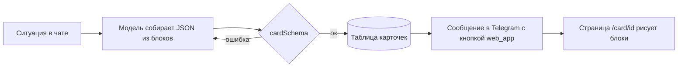

# Карточки Бро

Карточка — одна страница с готовым ответом на конкретную ситуацию: подтверждённый
рейс, сравнение трёх ресторанов, маршрут поездки. Бро присылает её в Telegram
сообщением с кнопкой «Открыть карточку», и страница открывается внутри Telegram
(Mini App). Обычный разговор остаётся в чате: карточка нужна, когда ответ — это
данные, а не реплика.

Идея та же, что у Instinct («Files», 18.09.2026: приватные или публичные
интерактивные страницы, которые агент собирает, когда одного текста мало:
сравнение квартир, маршрут, расчёт долгов в поездке) и у карточки подтверждения
(одобрение привязано к тексту, который человек увидел). Разбор Instinct —
`docs/instinct.md`.

## Как это работает

Заранее прописать формат под каждую ситуацию нельзя: их слишком много. Поэтому
есть **дизайн-система** — фиксированный набор токенов и блоков, — а карточку
под ситуацию **собирает модель**: берёт нужные блоки из каталога и заполняет их.
Схема (`shared/cards/schema.ts`) не даёт выйти за каталог: чужое поле, HTML и
ссылка не на https отвергаются, а модель получает ошибку и собирает заново.

Кнопку отправляет код, а не модель: у сообщений модели кнопок нет (так же сделана
кнопка ЮMoney, `agent/lib/yoomoney/onboarding.ts`).

## Токены

Бумага, чернила и белые плашки — те же, что на сайте
(`app/styles/brand/bro.css`, `foundation.css`). Дополнительные цвета — из
палитры бренда в файле Paper «bro · Hilos» (вкладка Theme).

| Токен   | Значение                                        | Роль                                               |
| ------- | ----------------------------------------------- | -------------------------------------------------- |
| canvas  | `#F1F2EE`                                       | фон страницы                                       |
| ink     | `#141510`                                       | текст, рамка плашки, главная кнопка                |
| white   | `#FFFFFF`                                       | плашка карточки                                    |
| muted   | `#6A6C62`                                       | подписи, второстепенный текст                      |
| line    | `#D2D4CB`                                       | разделители внутри плашки                          |
| blue    | `#B5D5F4`                                       | тон `info`, чип «голубой»                          |
| yellow  | `#F5DF8D`                                       | тон `warning`, чип «жёлтый»                        |
| pink    | `#F6CEDF`                                       | чип «розовый»                                      |
| coral   | `#F9B59F`                                       | тон `danger`, чип «коралловый»                     |
| error   | `#922A22`                                       | текст ошибки, текущая точка в `danger`             |
| success | `#E4F8E7` фон, `#75B683` линия, `#006622` текст | тон `success` (из `--success*` в `foundation.css`) |

Форма: плашка с рамкой 2 px чернилами и радиусом 24 px (`bro-plate`), кнопки и
чипы — капсулы (радиус 999), строки внутри — без рамок, только разделитель
1 px `line`. Отступы — шаг 4 (4, 8, 12, 16, 24, 32). Ширина карточки — до
480 px (`container`-плашка 30 rem), на узком экране — на всю ширину с полем
16 px.

Шрифты: заголовок и крупные значения — Source Serif 4 (400), всё остальное —
Geist (400 текст, 600 подписи и кнопки). Размеры: заголовок карточки 28/31,
заголовок раздела 20/24, крупное значение `stat` 40/44, время в `route` 32/36,
основной текст 16/24, строка списка 15/22, подпись 12/16 (кикер — заглавными
буквами, трекинг +0.04em).

## Тона

Тон карточки красит цветную полосу над заголовком и точку у кикера; тон
`callout` красит саму врезку. Тон — про смысл, а не про украшение.

| Тон       | Когда                                |
| --------- | ------------------------------------ |
| `neutral` | сравнения, справки, всё без оценки   |
| `info`    | планы, напоминания, «что дальше»     |
| `success` | сделано: билет, бронь, оплата прошли |
| `warning` | нужно решение или есть срок          |
| `danger`  | сорвалось, отказ, деньги не списаны  |

## Каталог блоков

Блоков 14. Модель берёт столько, сколько нужно (от 1 до 16), и не придумывает
новых.

| Блок        | Для чего                                                               | Пределы                                          |
| ----------- | ---------------------------------------------------------------------- | ------------------------------------------------ |
| `heading`   | заголовок раздела внутри карточки                                      | 80 знаков                                        |
| `text`      | абзац; `muted` — мелкий серый пояснительный                            | 600 знаков                                       |
| `facts`     | пары «подпись — значение» (пассажир, багаж, адрес)                     | до 12 строк                                      |
| `stat`      | одно крупное число: итог, остаток, срок                                | значение до 24 знаков                            |
| `list`      | варианты и покупки: заголовок, подзаголовок, сумма справа, чип, ссылка | до 12 строк                                      |
| `timeline`  | последовательность: маршрут дня, статус доставки                       | 2–10 шагов, `done`/`current`/`upcoming`          |
| `route`     | откуда → куда: рейс, поезд, такси                                      | два пункта с временем и кодом                    |
| `table`     | сравнение по признакам                                                 | 2–4 столбца, до 8 строк, `highlight` — выбранная |
| `callout`   | важное: срок, условие, предупреждение                                  | тон + до 300 знаков                              |
| `chips`     | метки: кухня, район, категория                                         | до 10                                            |
| `checklist` | что взять, что осталось сделать                                        | до 12 пунктов                                    |
| `image`     | фото места или товара (только https)                                   | подпись до 100 знаков                            |
| `copyable`  | значение, которое нужно скопировать: код брони, номер заказа           | 80 знаков                                        |
| `divider`   | граница между смысловыми частями                                       | —                                                |

Над блоками: `kicker` (до 40, «Билеты · оформлено»), `title` (до 80),
`subtitle` (до 160), `tone`. Под блоками: до трёх кнопок `actions` (ссылка
https, `tel:` или `mailto:`; не больше одной `primary`) и `footnote` (до 200).

## Как собирать

1. Сначала главное: первый блок отвечает на вопрос человека (`route`, `stat`,
   `table` или `list`), а не пересказывает заголовок.
2. Дальше подробности (`facts`, `timeline`, `checklist`), потом `callout` с тем, что
   важно не пропустить, и кнопки.
3. Раздел внутри карточки открывает `heading`, а разные по смыслу части
   отделяет `divider`. Не больше одного `stat` и одной `image` на экран.
4. Один тон на карточку; `callout` с другим тоном — только если он правда о
   другом (общий `success`, а срок — `warning`).
5. Текст — по-русски, с заглавной буквы в начале, без Markdown и эмодзи; суммы с
   неразрывным пробелом и знаком валюты («7 450 ₽»).
6. Сообщение в чате само отвечает на вопрос (одна-две строки: что сделано, главное
   число или срок), а карточка даёт подробности. Человек, который её не откроет,
   не должен остаться без ответа; карточка не повторяет то, что уже в сообщении.

## Когда карточка, когда чат

Чат ничего не стоит, карточка стоит тап, загрузку страницы и смену контекста.
Поэтому по умолчанию отвечает чат, а карточка нужна, когда она даёт то, чего чат
не даёт. Бро решает по двум шагам.

**Шаг 1. Запреты: карточки нет, только чат.**

- Ответа ждут от человека: вопрос, выбор «первый или второй», согласие, подтверждение
  оплаты (его просят обычным вопросом с суммой и ждут «да»; `docs/roadmap.md`, п. 6).
- Результат умещается в три строки без потерь (примерно до 250 знаков и четырёх
  фактов): заказал такси, купил в лавке, записал, оплатил, добавил в календарь,
  статус посылки, одна дата.
- Просьба с темпом: «быстро», «срочно», «сейчас». Человек ждёт один короткий ответ.
- Сбой или препятствие: одна строка, что случилось и что нужно от человека.
  Исключение: три и больше способов выйти, которые нужно сравнить.
- Чувствительное: результаты анализов, документы, паспортные данные, полные
  номера карт. Ссылка на страницу живёт 30 дней и её можно переслать, в чате такого
  риска нет.
- Напоминания и короткие сводки, которые приходят по расписанию, пока в них нет
  восьми и больше пунктов: открывать страницу каждое утро дороже, чем прочитать
  сообщение.

**Шаг 2. Только если запретов нет: карточка нужна, когда верно хотя бы одно.**

1. **Объём.** Подробности не влезают в пять строк чата без потерь: три и больше
   варианта с тремя и больше признаками (сравнение), пять и больше шагов, шесть и
   больше строк списка или фактов.
2. **Хранить.** К ответу вернутся: билет или бронь с кодом, адрес и временем, план
   поездки, расписание, чек-лист, итог по чекам, документы со сроками.
3. **Переслать.** Человек отправит это другим: план для друзей, расчёт долгов,
   выбор времени встречи, маршрут для семьи.
4. **Отчёт о длинной работе.** Поручение из пяти и больше шагов или с несколькими
   результатами и остатком для человека.

Если не верно ни одно, это чат, даже когда блоки в каталоге есть. Карточка на
каждый чих делает Бро шумным и приучает не открывать её. На размеченных запросах
бенчмарка русская выборка даёт примерно 28% карточек, 10% «на выбор» и 62% чата
(`docs/cards/policy-cases.json`: 60 запросов бенчмарка и 7 пограничных). Instinct делает
Files тоже только «чтобы сравнить варианты, проработать план или поделиться собранным»,
а в примерах переписки его открытого клона OpenInstinct покупки и записи идут обычными
сообщениями («cart's ready… want me to place it?», «placed. order #…»).

**Что куда в разговоре.**

- В чате сначала идёт сообщение с ответом, и только потом кнопка: «куплены билеты на
  «Сапсан» 31 октября в 08:00, вагон 5, места 12 и 14, 7 780 ₽. Код брони и детали
  в карточке».
- Не больше одной карточки за ход и ни одной в двух ответах подряд про одно и то же.
- Одно и то же в карточке и в чате не дублируется, но главное в чате остаётся.
- Серая зона («на выбор») решается так: сомневаешься, отвечай чатом.

Из 37 примеров на доске Paper в бою ушли бы чатом такси, платёж ЮMoney, погода,
доставка еды, квартплата и «поручение застряло». Они показывают, как выглядит
карточка, а не когда её слать.

### Как внедрять

1. **Инструкция и описание `send_card`.** Заменить «когда ответ — данные, а не реплика»
   на оба шага выше с числами и примерами из таблицы случаев; в описании `message`
   написать «ответ человеку в одну-две строки», а не «зачем карточка».
2. **Проверка в коде, а не только в промпте** (у телефонного агента промпт не удержал
   правило, пока модель шла без рассуждений, `docs/dev-notes.md`). `send_card` отказывает,
   если в карточке меньше двух блоков или меньше шести единиц данных, а в словах
   человека за этот ход есть «быстро», «срочно», «сейчас». Единица данных: строка
   `facts` или `list`, шаг `timeline`, пункт `checklist`, ячейка `table` без заголовка;
   `route`, `stat`, `copyable` и `callout` считаются по одной. Три примера из
   репозитория этот порог проходят (7, 16 и 8 единиц); дальше его подбирают по
   `policy-cases.json`. Отказ возвращает модели причину («это умещается в чат, ответь
   сообщением»). Лимит карточек за ход снизить с двух до одной.
3. **Замер.** Хранить, открыли ли карточку (первое чтение `/card/<id>`: `opened_at`), и
   смотреть долю открытых: если открывают меньше трети, правило слишком щедрое.
4. **Эвалы.** `docs/cards/policy-cases.json`: запрос, ожидаемое (`chat`, `card`,
   `either`) и причина. В эвале для `either` оба ответа верны; ошибкой считается
   карточка там, где ждали `chat`, и чат там, где ждали `card`. Оформить как `evals/agent/cards.eval.ts` по образцу `delivery.eval.ts`.

## Данные и безопасность

- Ссылка на карточку — секрет (длинный случайный идентификатор), страница
  `noindex`, превью чата не должно её открывать раньше человека.
- В карточке нет паролей, полных номеров карт, одноразовых кодов и документов;
  то, что нельзя показывать в чате, нельзя показывать и тут. Номер карты —
  только последние четыре цифры.
- Карточка читается только; кнопки — ссылки. Действия, меняющие что-то у Бро
  (оплата, согласие), идут обычным разговором.
- Срок жизни — 30 дней; после него страница честно говорит, что карточки нет.
- Только текст и данные: HTML, стили, скрипты и ссылки не на https схема
  отвергает.

## Где что лежит

| Что                                            | Где                                                  |
| ---------------------------------------------- | ---------------------------------------------------- |
| Схема и каталог блоков                         | `shared/cards/schema.ts`                             |
| Примеры карточек (по ним же проверяется схема) | `docs/cards/examples/*.json`                         |
| Рендер блоков                                  | `web/components/cards/`                              |
| Страница в Telegram                            | `app/(public)/card/[id]`                             |
| Дизайн-система в Paper                         | файл «bro · Hilos», страница «Cards · Design system» |
