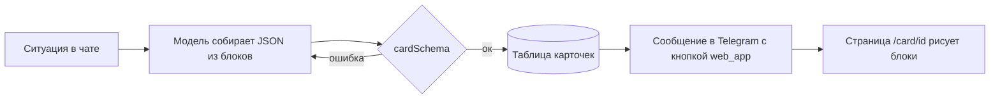

# Карточки Бро

Карточка — одна страница с готовым ответом на конкретную ситуацию: подтверждённый
рейс, сравнение трёх ресторанов, маршрут поездки. Бро присылает её в Telegram
сообщением с кнопкой «Открыть карточку», и страница открывается внутри Telegram
(Mini App). Обычный разговор остаётся в чате: карточка нужна, когда ответ — это
данные, а не реплика.

Идея та же, что у Instinct («Files», 18.09.2026: приватные или публичные
интерактивные страницы, которые агент собирает, когда одного текста мало:
сравнение квартир, маршрут, расчёт долгов в поездке) и у карточки подтверждения
(одобрение привязано к тексту, который человек увидел). Разбор Instinct —
`docs/instinct.md`.

## Как это работает

Заранее прописать формат под каждую ситуацию нельзя: их слишком много. Поэтому
есть **дизайн-система** — фиксированный набор токенов и блоков, — а карточку
под ситуацию **собирает модель**: берёт нужные блоки из каталога и заполняет их.
Схема (`shared/cards/schema.ts`) не даёт выйти за каталог: чужое поле, HTML и
ссылка не на https отвергаются, а модель получает ошибку и собирает заново.

Кнопку отправляет код, а не модель: у сообщений модели кнопок нет (так же сделана
кнопка ЮMoney, `agent/lib/yoomoney/onboarding.ts`).

## Токены

Бумага, чернила и белые плашки — те же, что на сайте
(`app/styles/brand/bro.css`, `foundation.css`). Дополнительные цвета — из
палитры бренда в файле Paper «bro · Hilos» (вкладка Theme).

| Токен   | Значение                                        | Роль                                               |
| ------- | ----------------------------------------------- | -------------------------------------------------- |
| canvas  | `#F1F2EE`                                       | фон страницы                                       |
| ink     | `#141510`                                       | текст, рамка плашки, главная кнопка                |
| white   | `#FFFFFF`                                       | плашка карточки                                    |
| muted   | `#6A6C62`                                       | подписи, второстепенный текст                      |
| line    | `#D2D4CB`                                       | разделители внутри плашки                          |
| blue    | `#B5D5F4`                                       | тон `info`, чип «голубой»                          |
| yellow  | `#F5DF8D`                                       | тон `warning`, чип «жёлтый»                        |
| pink    | `#F6CEDF`                                       | чип «розовый»                                      |
| coral   | `#F9B59F`                                       | тон `danger`, чип «коралловый»                     |
| error   | `#922A22`                                       | текст ошибки, текущая точка в `danger`             |
| success | `#E4F8E7` фон, `#75B683` линия, `#006622` текст | тон `success` (из `--success*` в `foundation.css`) |

Форма: плашка с рамкой 2 px чернилами и радиусом 24 px (`bro-plate`), кнопки и
чипы — капсулы (радиус 999), строки внутри — без рамок, только разделитель
1 px `line`. Отступы — шаг 4 (4, 8, 12, 16, 24, 32). Ширина карточки — до
480 px (`container`-плашка 30 rem), на узком экране — на всю ширину с полем
16 px.

Шрифты: заголовок и крупные значения — Source Serif 4 (400), всё остальное —
Geist (400 текст, 600 подписи и кнопки). Размеры: заголовок карточки 28/31,
заголовок раздела 20/24, крупное значение `stat` 40/44, время в `route` 32/36,
основной текст 16/24, строка списка 15/22, подпись 12/16 (кикер — заглавными
буквами, трекинг +0.04em).

## Тона

Тон карточки красит цветную полосу над заголовком и точку у кикера; тон
`callout` красит саму врезку. Тон — про смысл, а не про украшение.

| Тон       | Когда                                |
| --------- | ------------------------------------ |
| `neutral` | сравнения, справки, всё без оценки   |
| `info`    | планы, напоминания, «что дальше»     |
| `success` | сделано: билет, бронь, оплата прошли |
| `warning` | нужно решение или есть срок          |
| `danger`  | сорвалось, отказ, деньги не списаны  |

## Каталог блоков

Блоков 14. Модель берёт столько, сколько нужно (от 1 до 16), и не придумывает
новых.

| Блок        | Для чего                                                               | Пределы                                          |
| ----------- | ---------------------------------------------------------------------- | ------------------------------------------------ |
| `heading`   | заголовок раздела внутри карточки                                      | 80 знаков                                        |
| `text`      | абзац; `muted` — мелкий серый пояснительный                            | 600 знаков                                       |
| `facts`     | пары «подпись — значение» (пассажир, багаж, адрес)                     | до 12 строк                                      |
| `stat`      | одно крупное число: итог, остаток, срок                                | значение до 24 знаков                            |
| `list`      | варианты и покупки: заголовок, подзаголовок, сумма справа, чип, ссылка | до 12 строк                                      |
| `timeline`  | последовательность: маршрут дня, статус доставки                       | 2–10 шагов, `done`/`current`/`upcoming`          |
| `route`     | откуда → куда: рейс, поезд, такси                                      | два пункта с временем и кодом                    |
| `table`     | сравнение по признакам                                                 | 2–4 столбца, до 8 строк, `highlight` — выбранная |
| `callout`   | важное: срок, условие, предупреждение                                  | тон + до 300 знаков                              |
| `chips`     | метки: кухня, район, категория                                         | до 10                                            |
| `checklist` | что взять, что осталось сделать                                        | до 12 пунктов                                    |
| `image`     | фото места или товара (только https)                                   | подпись до 100 знаков                            |
| `copyable`  | значение, которое нужно скопировать: код брони, номер заказа           | 80 знаков                                        |
| `divider`   | граница между смысловыми частями                                       | —                                                |

Над блоками: `kicker` (до 40, «Билеты · оформлено»), `title` (до 80),
`subtitle` (до 160), `tone`. Под блоками: до трёх кнопок `actions` (ссылка
https, `tel:` или `mailto:`; не больше одной `primary`) и `footnote` (до 200).

## Как собирать

1. Сначала главное: первый блок отвечает на вопрос человека (`route`, `stat`,
   `table` или `list`), а не пересказывает заголовок.
2. Дальше подробности (`facts`, `timeline`, `checklist`), потом `callout` с тем, что
   важно не пропустить, и кнопки.
3. Раздел внутри карточки открывает `heading`, а разные по смыслу части
   отделяет `divider`. Не больше одного `stat` и одной `image` на экран.
4. Один тон на карточку; `callout` с другим тоном — только если он правда о
   другом (общий `success`, а срок — `warning`).
5. Текст — по-русски, с заглавной буквы в начале, без Markdown и эмодзи; суммы с
   неразрывным пробелом и знаком валюты («7 450 ₽»).
6. Карточка не дублирует сообщение в чате: в сообщении — одна-две строки, зачем
   она; в карточке — данные.

Когда карточка **не нужна**: короткий ответ, один факт, вопрос к человеку,
подтверждение оплаты (его просят обычным вопросом, `docs/roadmap.md`, п. 6).
Карточка — не форма и не способ получить согласие.

## Данные и безопасность

- Ссылка на карточку — секрет (длинный случайный идентификатор), страница
  `noindex`, превью чата не должно её открывать раньше человека.
- В карточке нет паролей, полных номеров карт, одноразовых кодов и документов;
  то, что нельзя показывать в чате, нельзя показывать и тут. Номер карты —
  только последние четыре цифры.
- Карточка читается только; кнопки — ссылки. Действия, меняющие что-то у Бро
  (оплата, согласие), идут обычным разговором.
- Срок жизни — 30 дней; после него страница честно говорит, что карточки нет.
- Только текст и данные: HTML, стили, скрипты и ссылки не на https схема
  отвергает.

## Где что лежит

| Что                                            | Где                                                  |
| ---------------------------------------------- | ---------------------------------------------------- |
| Схема и каталог блоков                         | `shared/cards/schema.ts`                             |
| Примеры карточек (по ним же проверяется схема) | `docs/cards/examples/*.json`                         |
| Рендер блоков                                  | `web/components/cards/`                              |
| Страница в Telegram                            | `app/(public)/card/[id]`                             |
| Дизайн-система в Paper                         | файл «bro · Hilos», страница «Cards · Design system» |
